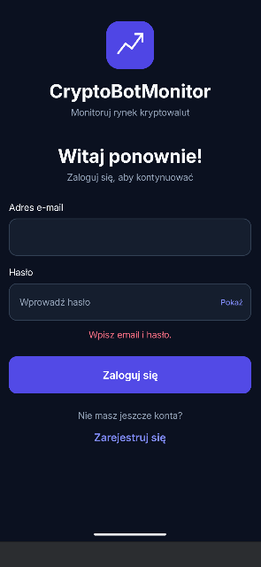
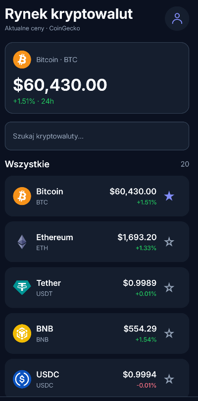
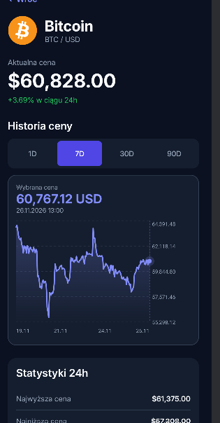
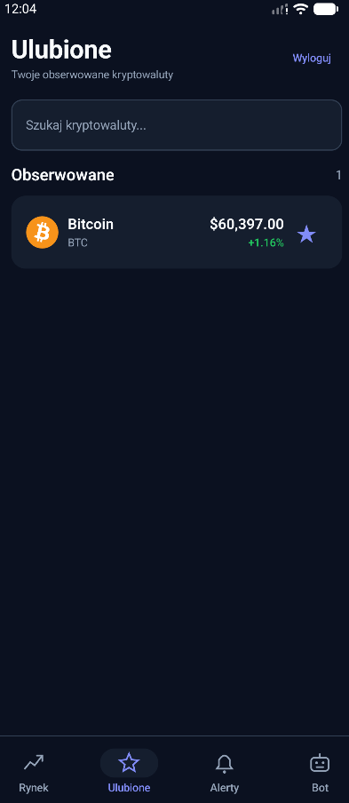
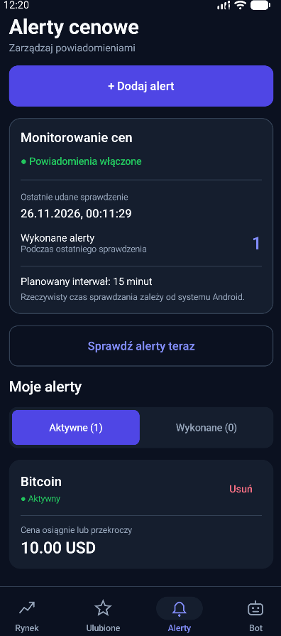
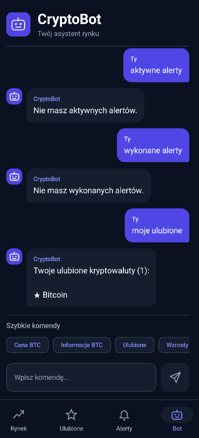
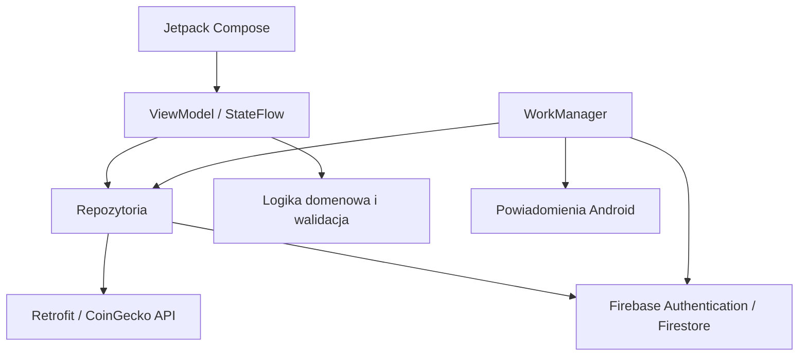
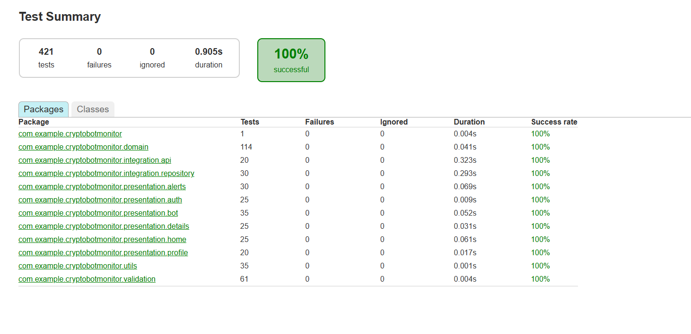
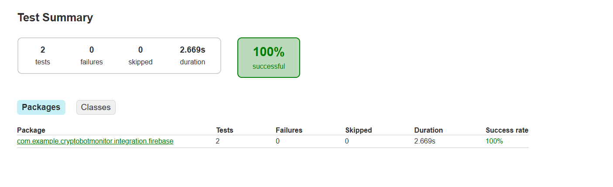

# CryptoBotMonitor

Aplikacja mobilna na Androida z botem do monitorowania rynku kryptowalut i systemem powiadomień o zmianach cen. Projekt został zrealizowany w ramach pracy inżynierskiej na kierunku Informatyka.

## Funkcjonalności

- Rejestracja, logowanie i wylogowanie użytkownika.
- Lista kryptowalut z cenami w USD i zmianami cen w ciągu 24 godzin.
- Wyszukiwanie kryptowalut według nazwy lub symbolu oraz lista ulubionych.
- Szczegóły kryptowaluty, statystyki i interaktywny wykres historyczny (1, 7, 30 lub 90 dni).
- Alerty cenowe z warunkiem powyżej lub poniżej wskazanej ceny, podział na aktywne i wykonane.
- Okresowe oraz ręczne sprawdzanie alertów i lokalne powiadomienia Android.
- Bot tekstowy do pobierania informacji rynkowych i zarządzania alertami.
- Profil użytkownika ze statystykami i dostępem do ustawień powiadomień.

## Interfejs aplikacji

Poniższe zrzuty przedstawiają aplikację w trakcie końcowych etapów rozwoju. Widoczne ceny są przykładowymi danymi z chwili wykonania zrzutu.

| Logowanie | Rynek | Szczegóły i wykres |
| :---: | :---: | :---: |
|  |  |  |

| Ulubione | Alerty | CryptoBot |
| :---: | :---: | :---: |
|  |  |  |

[Projekt interfejsu w Figma](https://www.figma.com/design/yBt3cnGbCxpXiykJGp9DXQ/CryptoBotMonitor-%E2%80%93-UI-UX-Design?node-id=0-1)

## Technologie

| Technologia | Zastosowanie |
| --- | --- |
| Kotlin, Jetpack Compose | Logika aplikacji i interfejs użytkownika |
| MVVM, StateFlow, Coroutines | Zarządzanie stanem i operacje asynchroniczne |
| Retrofit, OkHttp, Gson | Komunikacja HTTP i przetwarzanie JSON |
| CoinGecko API | Dane rynkowe i historyczne |
| Firebase Authentication | Zarządzanie kontami |
| Cloud Firestore | Przechowywanie alertów i ulubionych kryptowalut |
| WorkManager | Okresowe sprawdzanie warunków alertów |
| JUnit, MockWebServer, Firebase Emulator Suite | Testowanie aplikacji |

## Architektura

Aplikacja wykorzystuje wzorzec MVVM oraz podział na warstwy. Zależności są przekazywane przez konstruktory, co pozwala zastępować repozytoria ich wersjami testowymi.



Główne pakiety kodu:

```text
com.example.cryptobotmonitor/
├── data/          # API, modele, repozytoria, autoryzacja
├── domain/        # Logika biznesowa
├── presentation/  # Ekrany i ViewModel
├── notification/  # Obsługa powiadomień
├── worker/        # Monitorowanie cen w tle
├── validation/    # Walidacja danych
├── utils/         # Funkcje pomocnicze
└── ui/            # Motyw i komponenty interfejsu
```

## Komendy bota

| Komenda | Działanie |
| --- | --- |
| `pomoc` | Lista dostępnych komend |
| `cena btc` | Aktualna cena Bitcoin |
| `info bitcoin` | Szczegółowe informacje |
| `top wzrosty` / `top spadki` | Największe zmiany wśród pobranych kryptowalut |
| `moje ulubione` | Lista ulubionych |
| `alert btc powyżej 70000` | Utworzenie alertu |
| `alert eth poniżej 1500` | Utworzenie alertu |
| `moje alerty` | Wszystkie alerty |
| `aktywne alerty` / `wykonane alerty` | Alerty według statusu |
| `usuń alert btc` | Usunięcie alertów dla Bitcoin |

Bot korzysta z parsera komend tekstowych; nie jest modelem generatywnej sztucznej inteligencji.

## Monitorowanie i bezpieczeństwo

WorkManager planuje okresowe sprawdzanie cen w interwale 15 minut. Po spełnieniu warunku alertu aplikacja podejmuje próbę wysłania powiadomienia; po udanym wysłaniu alert zostaje oznaczony jako wykonany. Możliwe jest także ręczne uruchomienie sprawdzania.

Dane użytkowników chronią reguły Firestore ograniczające dostęp do własnych dokumentów i sprawdzające poprawność zapisywanych danych. Aplikacja wykorzystuje pamięć podręczną cen (60 sekund) i wykresów (5 minut) oraz czasową blokadę kolejnych zapytań po odpowiedzi HTTP 429.

## Testowanie

W trakcie rozwoju uzyskano następujące wyniki w osobnych uruchomieniach testów:

| Zakres | Wynik |
| --- | ---: |
| Logika biznesowa, walidacja i formatowanie | 210/210 |
| ViewModel | 160/160 |
| Standardowy test JUnit | 1/1 |
| CoinGecko API – MockWebServer | 20/20 |
| CoinRepository – cache i błędy HTTP | 30/30 |
| Połączenie z emulatorami Firebase (Android) | 2/2 |
| Reguły bezpieczeństwa Firestore | 30/30 |
| **Razem** | **453/453** |

Ostatni udokumentowany wspólny przebieg testów JVM: **421/421**, 27.11.2026. Testy Android oraz reguł Firestore uruchamiano osobno. Wykonano również końcowe testowanie ręczne aplikacji. Wyniki nie oznaczają pełnego pokrycia kodu.

<details>
<summary>Raporty z testów</summary>





</details>

## Uruchomienie projektu

Wymagania: Android Studio, JDK 17 lub nowszy zgodny z Gradle (podczas rozwoju używano JDK 21), Android SDK 36 oraz urządzenie lub emulator z Androidem 8.0 (API 26) lub nowszym.

1. Sklonuj repozytorium i otwórz projekt w Android Studio.
2. Skonfiguruj projekt Firebase: Authentication (Email/Password) i Cloud Firestore. Dodaj właściwy plik `google-services.json` do katalogu `app/`, zgodny z identyfikatorem aplikacji `com.example.cryptobotmonitor`, oraz wdroż reguły z `firestore.rules` do własnego projektu Firebase.
3. Zsynchronizuj Gradle i uruchom konfigurację `app` na urządzeniu lub emulatorze.

Budowanie i testy JVM w PowerShell:

```powershell
.\gradlew.bat :app:assembleDebug
.\gradlew.bat :app:testDebugUnitTest
```

Testy połączenia z Firebase wymagają uruchomienia lokalnego Firebase Emulator Suite (Firebase CLI) oraz emulatora Android:

```powershell
firebase emulators:start --only auth,firestore --project demo-cryptobotmonitor
```

W osobnym terminalu:

```powershell
.\gradlew.bat :app:connectedDebugAndroidTest "-Pandroid.testInstrumentationRunnerArguments.class=com.example.cryptobotmonitor.integration.firebase.FirebaseConnectionTest"
```

## Ograniczenia

- Dane zależą od dostępności i limitów CoinGecko API. W przypadku ograniczenia zapytań niektóre ekrany mogą wyświetlać dane z pamięci podręcznej.
- Android decyduje o rzeczywistym czasie uruchomienia zadań WorkManager. Interwał 15 minut nie gwarantuje dokładnego czasu dostarczenia powiadomienia.
- Dostarczenie powiadomień zależy od uprawnień, ustawień systemu i dostępności sieci.
- Aplikacja ma charakter informacyjny i nie umożliwia handlu kryptowalutami.

## Autor

Danylo Smiian – projekt inżynierski, Informatyka, Uniwersytet Dolnośląski Ideis DSW
